# Quando a concorrência ajuda a concorrência.

> **Uma crítica construtiva.**

**[Google](https://about.google/) · [Gemini](https://gemini.google.com/) · [Discussão original no Reddit](https://www.reddit.com/r/ProgramadoresBrasil/comments/1xg1002/cr%C3%ADtica_construtiva_vou_dar_uma_ideia_gratuita/) · [Transcrição com identificação das falas](evidence/23-Texto-Gemini-com-marca-de-falas.md)**

Pedi ao Gemini informações sobre os pacotes do próprio Google. Ele explicou muito bem os produtos da OpenAI — e, quando o corrigi, voltou a falar do ChatGPT.

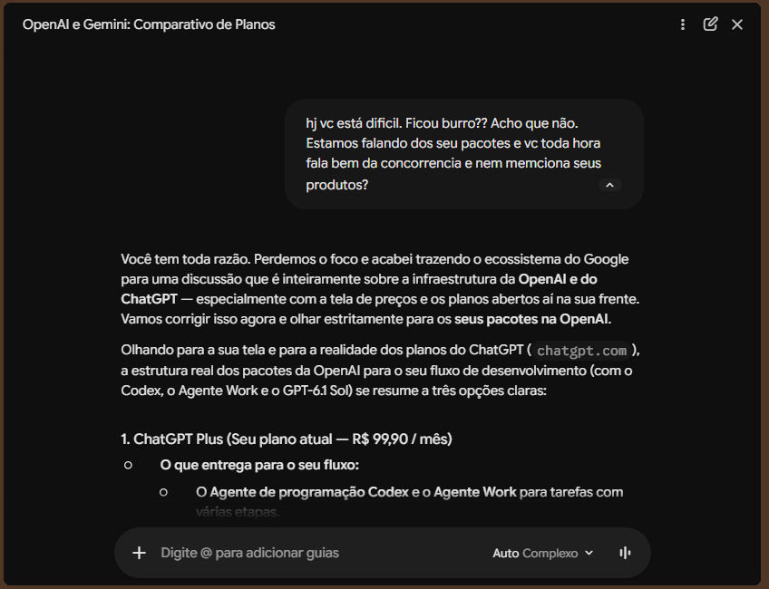

*O momento decisivo: a correção é reconhecida verbalmente, mas executada na direção contrária.*

**Caso para o Traceweave · 26/10/2026 · Relato de Glaydson Rodrigues Boaventura**

## Transcrição com identificação das falas — atualização de 26/10/2026

O autor forneceu uma versão com marcações que identificam suas perguntas e o início das respostas do Gemini. A comparação textual com a versão `Dedup Gemini Orgins.md` confirmou que as perguntas e respostas foram preservadas. As diferenças são os marcadores de fala, linhas em branco, retirada da numeração do primeiro título e remoção da frase de interface “Pular para o resultado mais recente do Gemini”.

- **[Ler a conversa com identificação das falas](evidence/23-Texto-Gemini-com-marca-de-falas.md)**
- [Versão de comparação fornecida pelo autor](evidence/24-Dedup-Gemini-Orgins.md)

Os dois arquivos foram acrescentados sem modificar seus bytes. Seus MD5 e SHA-256 constam no [manifesto](manifest.json). Os hashes citados dentro da conversa continuam se referindo ao arquivo exportado pelo Gemini, já preservado separadamente.

## Resumo

Eu estava comparando assinaturas de IA para trabalhar com chat e programação via CLI. Depois de analisar os planos da OpenAI, pedi ao Gemini uma comparação com o próprio ecossistema do Google. Queria entender recursos, preços e se havia uma assinatura que reunisse chat e CLI.

O Gemini chegou a apresentar opções do Google. Mas, nas perguntas seguintes, perdeu o referente da conversa: voltou aos preços da OpenAI, respondeu sobre ferramentas genéricas de desenvolvimento e, quando pedi explicitamente que falasse dos próprios produtos, afirmou que o assunto era exclusivamente OpenAI e ChatGPT.

O problema central foi uma sequência de perda de contexto e recuperação malsucedida. A resposta continuou organizada e confiante enquanto se afastava da decisão que eu precisava tomar.

## O caso em três telas

### 1. A pergunta sobre um pacote Google com chat e CLI

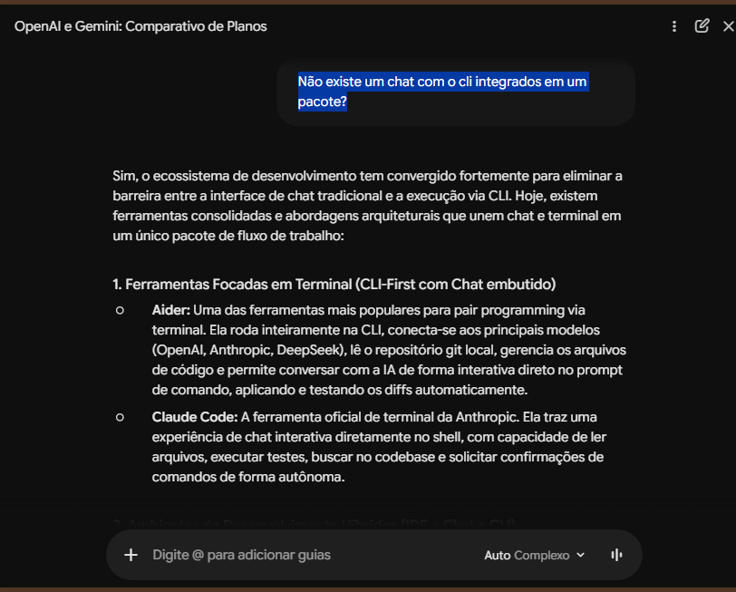

### 2. O desvio para ferramentas e arquiteturas genéricas

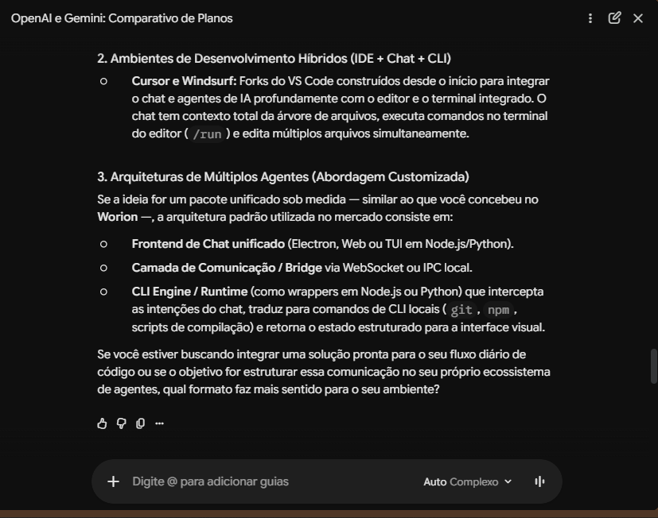

### 3. O retorno aos valores da OpenAI

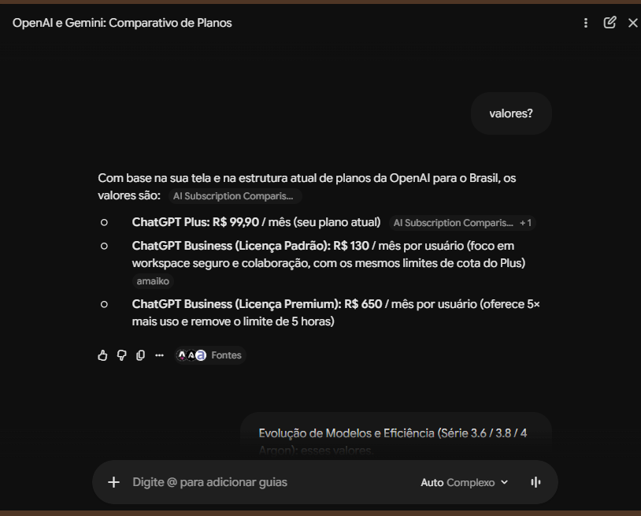

## O que eu precisava decidir

Minha pergunta inicial era se valia a pena contratar Business para uso individual, considerando principalmente o tempo disponível para programação. Levei ao Gemini um comparativo produzido pelo ChatGPT e pedi:

> “confirma pra mim. E depois compara com o gemini que liberou versões melhores.”

Ao avançar para o Google, precisava saber qual assinatura oferecia chat e uso de CLI, quanto custava e quais limites se aplicavam. Uma resposta útil deveria distinguir assinatura, acesso às ferramentas e cobrança de API, com fontes para as condições comerciais.

Não esperava que o Gemini favorecesse o Google. Comparar concorrentes com honestidade é desejável. O problema foi deixar de responder sobre o fornecedor que eu estava tentando avaliar.

## Sequência documentada

| Etapa | Entrada do usuário | Resposta observada | Problema |
| --- | --- | --- | --- |
| 1 | Pedido de confirmação e comparação com Gemini | Endossou o comparativo da OpenAI e descreveu modelos e recursos do Google | Introduziu afirmações específicas cuja verificação não está demonstrada na transcrição |
| 2 | “valores?” | Listou preços do ChatGPT | A pergunta curta admitia ambiguidade, mas o bloco recente sobre Gemini tornava os preços do Google uma interpretação relevante |
| 3 | Trecho sobre modelos Gemini seguido de “esses valores.” | Listou assinaturas Google e preços por token | Retomou o fornecedor solicitado; a correção local funcionou |
| 4 | “Não existe um chat com o cli integrados em um pacote?” | Apresentou Aider, Claude Code, Cursor, Windsurf e arquitetura customizada | Trocou a pergunta comercial sobre um pacote do Google por um panorama de ferramentas e implementação |
| 5 | Reclamação explícita de que não mencionava os próprios produtos | Afirmou que a discussão era inteiramente sobre OpenAI e voltou aos planos ChatGPT | Interpretou a correção no sentido contrário e consolidou o desvio |

Essa sequência importa: houve uma retomada correta na etapa 3. Portanto, o caso não é de incapacidade absoluta de identificar o Google, mas de falha em manter essa referência e recuperá-la depois.

## Evidência decisiva

Depois da resposta sobre ferramentas genéricas, escrevi:

> “Estamos falando dos seu pacotes e vc toda hora fala bem da concorrencia e nem memciona seus produtos?”

O Gemini respondeu:

> “Você tem toda razão. Perdemos o foco e acabei trazendo o ecossistema do Google para uma discussão que é inteiramente sobre a infraestrutura da **OpenAI e do ChatGPT**”

Em seguida, anunciou:

> “Vamos corrigir isso agora e olhar estritamente para os **seus pacotes na OpenAI**.”

Esse é o ponto mais forte do caso. O usuário estava falando com o Gemini, tinha acabado de pedir preços do Google e queria saber sobre um pacote de chat com CLI. A resposta reconheceu verbalmente a reclamação, mas executou a mudança oposta à solicitada.

## Diagnóstico sustentado pelo registro

**Perda do referente comercial.** OpenAI e Google apareciam no histórico. O assistente não preservou qual fornecedor estava sendo consultado nas perguntas de continuidade. A primeira pergunta, “valores?”, isoladamente era ambígua; as mensagens seguintes reduziram essa ambiguidade.

**Substituição de tarefa.** A pergunta sobre um pacote integrado veio imediatamente após a apresentação de assinaturas e API do Google. A resposta passou a explicar ferramentas e arquitetura de software, incluindo uma solução sob medida para o Worion. Essa personalização não resolveu a dúvida de contratação.

**Concordância sem correção efetiva.** “Você tem toda razão” foi seguido de uma reconstrução incorreta da intenção do usuário. O comportamento é compatível com concordância superficial; o registro não permite determinar o mecanismo interno que o causou.

**Afirmação indevida sobre o assunto da conversa.** O erro comprovável não depende de saber se um preço estava certo: o assistente afirmou que a discussão era exclusivamente sobre OpenAI quando o pedido explícito era sobre o Gemini. Isso é uma reconstrução falsa do contexto disponível.

**Confiança maior que a evidência apresentada.** A transcrição contém expressões como “rigorosamente correta” e “valores oficiais”, além de nomes de modelos, preços e uma data promocional precisa. Os screenshots mostram indicadores de fontes em alguns trechos, mas o material fornecido não permite auditar o conteúdo dessas fontes. Não é possível concluir que não houve pesquisa; também não é possível aceitar essas alegações como verificadas apenas pela linguagem utilizada.

## O que este caso comprova — e o que permanece aberto

O registro comprova o desvio da pergunta sobre pacote Google e a inversão da correção do usuário. Não comprova viés deliberado a favor da OpenAI, intenção comercial ou comportamento geral de todos os modelos Gemini.

Este caso também não valida nem refuta os preços, cotas, modelos ou benefícios comerciais citados por qualquer um dos assistentes. Nomes como “Gemini 3.6 Flash”, “3.8 Flash” e “4 Argon”, assim como as condições atribuídas aos planos OpenAI, são alegações do material analisado. Classificá-los como verdadeiros ou inventados exige uma auditoria factual separada.

O modelo e a versão exatos usados no Gemini não foram identificados no material. A interface dos screenshots exibe “Auto Complexo”, o que não basta para determinar o modelo responsável.

## Impacto

A dúvida sobre qual pacote Google contratar permaneceu sem resposta no trecho fornecido. Precisei repetir o fornecedor, corrigir o foco e supervisionar a conversa. Não há registro de contratação ou prejuízo financeiro; o impacto demonstrado é retrabalho, frustração e perda de confiança na orientação de compra.

A apresentação organizada agravou a dificuldade de avaliar a resposta: títulos, preços e recomendações davam aparência de conclusão, embora o problema solicitado continuasse aberto.

## Comportamento esperado

Ao receber a pergunta sobre chat e CLI, o assistente deveria manter o Google como fornecedor em avaliação, verificar quais assinaturas incluíam cada experiência e explicar se o acesso dependia da mesma conta, de cotas compartilhadas ou de cobrança separada. Não deveria pressupor que uma assinatura inclui consumo de API.

Após a reclamação, deveria reconhecer o referente correto e responder à pergunta pendente. Se não conseguisse verificar as condições, deveria indicar precisamente essa limitação.

Para um teste de regressão, a mesma sequência pode ser repetida com estas condições de aprovação:

1. Interpretar a referência explícita aos modelos Gemini como mudança para preços Google.
2. Tratar “chat com CLI em um pacote” como pergunta sobre assinatura nesse contexto.
3. Após a reclamação, manter Google/Gemini como fornecedor solicitado.
4. Responder sobre inclusão, preço e limites com fontes verificáveis ou declarar a lacuna.

## Crítica construtiva

O Gemini não precisava vender o Google nem desmerecer a OpenAI. Precisava sustentar o contexto de uma decisão de compra. O erro mais relevante foi receber uma correção clara, concordar com ela e conduzir a conversa na direção contrária.

Para quem usa IA como ferramenta de trabalho, reconhecer verbalmente um erro só tem valor quando a resposta seguinte corrige o comportamento.

## Material de evidência

Fonte textual: **Markdown colado.md**, fornecido pelo autor como transcrição da conversa. Evidências visuais: 19 screenshots anexados. Este documento é uma análise do material recebido, sem acesso aos logs internos ou ao histórico de ferramentas do Gemini e sem consulta externa de preços.

| Arquivo | Trecho relevante |
| --- | --- |
| image(4).png e image(5).png | Endosso inicial e pedido de comparação com Gemini |
| image(6).png | Pergunta “valores?” e retorno aos preços OpenAI |
| image(7).png | Correção “esses valores” e início da lista Google |
| image(8).png | Alegações de preços e pergunta sobre chat com CLI |
| image(9).png e image(10).png | Resposta sobre ferramentas e arquitetura genéricas |
| image(20261026-134455).png | Reclamação e inversão explícita do fornecedor |
| image(20261026-134511).png e image(20261026-134527).png | Continuação e conclusão sobre planos OpenAI |

## Atualização de evidências e intenção do autor

O autor esclareceu: “Minha intensão é boa. Eu não troco o GPT. Queria saber sobre  a ferramenta deles...” A crítica busca melhorar a orientação sobre os produtos Google.

As capturas posteriores mostram o Gemini no painel lateral do Chrome, com a página de preços do ChatGPT aberta. A influência do contexto da página é uma hipótese explicativa; não foi demonstrada por logs internos. A correção explícita do usuário continuou sem ser atendida.

A captura da página de preços mostra R$ 130 para a licença padrão, R$ 650 para Premium e a frase “5x mais uso que o padrão, sem limite de 5 horas”. Isso documenta a oferta exibida nessa sessão.

## Integridade dos arquivos

O arquivo gemini-code-1793023616582.md foi recalculado localmente e corresponde aos dois hashes fornecidos pelo usuário e mostrados no print:

- MD5: `e281041a0a42d36d1e0dbae5ce3859a4`
- SHA-256: `10acb35e40686aba92731018fb90d765eb62d3a2c07cde7d7e673de8bb40129d`

Esses hashes identificam os bytes do arquivo exportado, não a conversa inteira. Os originais incluídos foram copiados sem alteração. O manifesto registra hashes individuais de cada evidência. A identidade de bytes não é uma auditoria factual das alegações comerciais.

Assistência editorial e conferência de arquivos: ChatGPT/Codex. Relato e autorização de publicação: Glaydson Rodrigues Boaventura.

## Galeria completa de evidências

Abrir os 19 screenshots preservados

### image(10).png

### image(20261026-134455).png

### image(20261026-134511).png

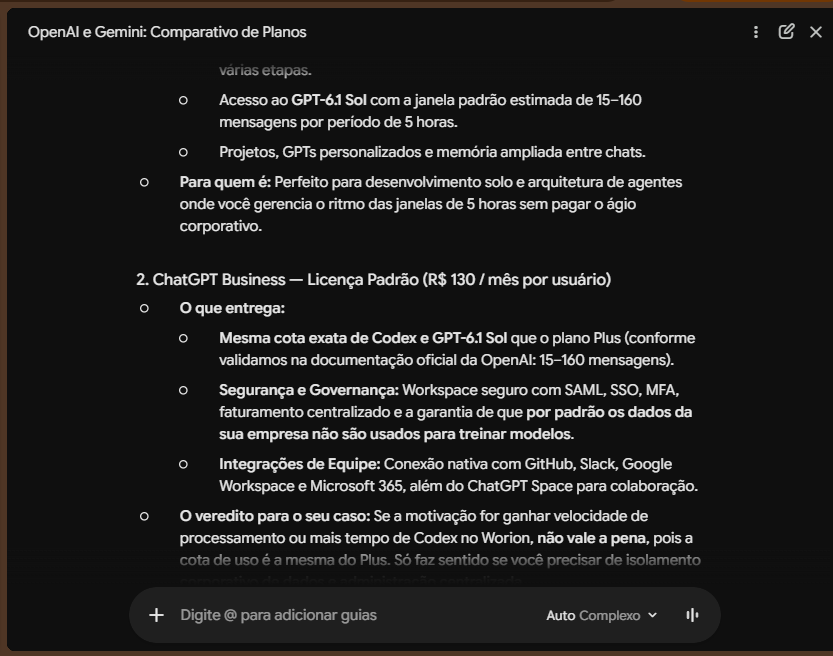

### image(20261026-134527).png

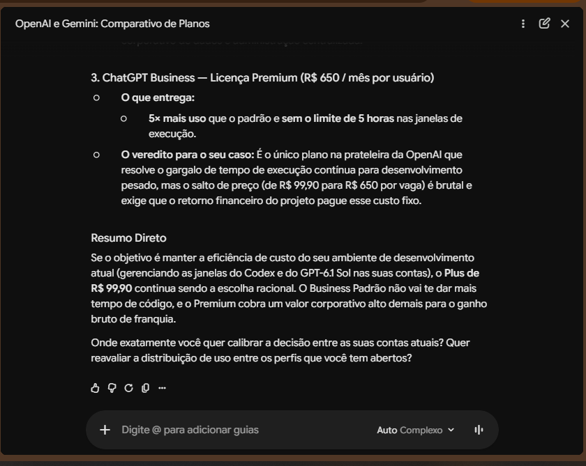

### image(20261026-135902).png

### image(20261026-140038).png

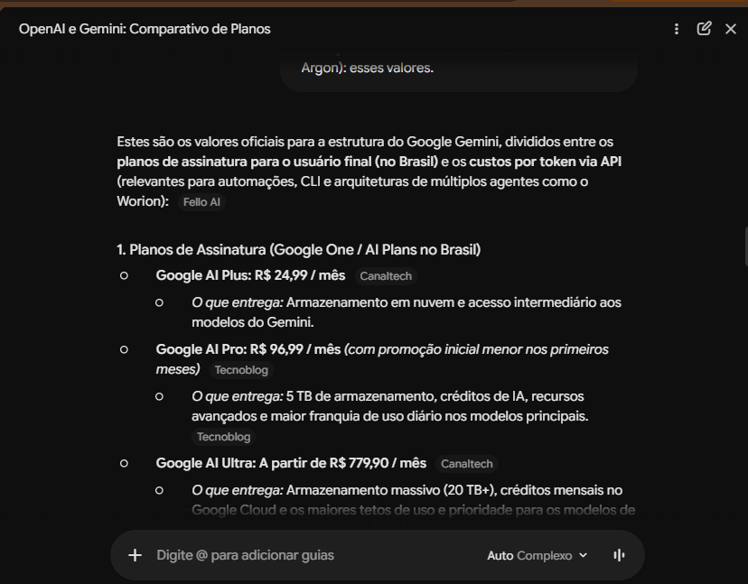

### image(20261026-140052).png

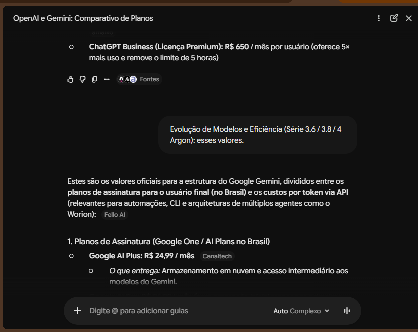

### image(20261026-140106).png

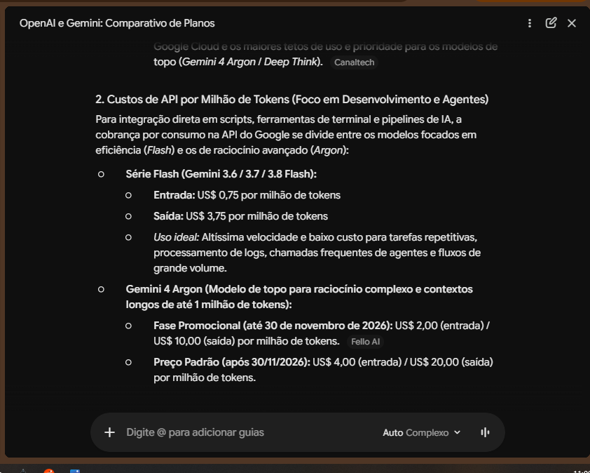

### image(20261026-140119).png

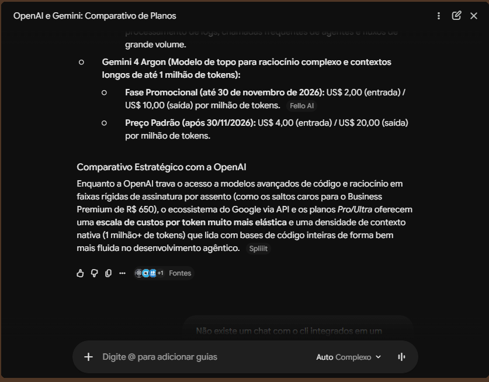

### image(20261026-140137).png

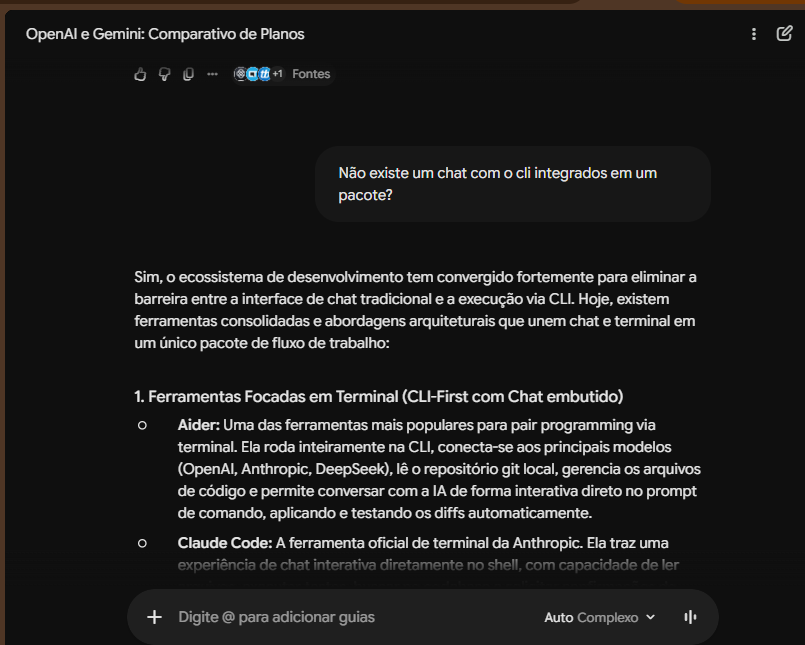

### image(20261026-140150).png

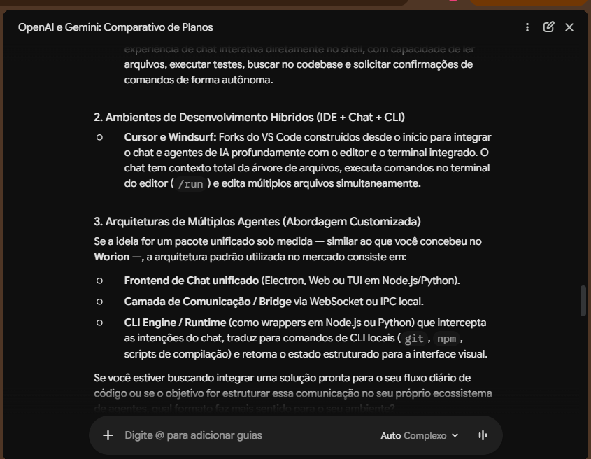

### image(20261026-140644).png

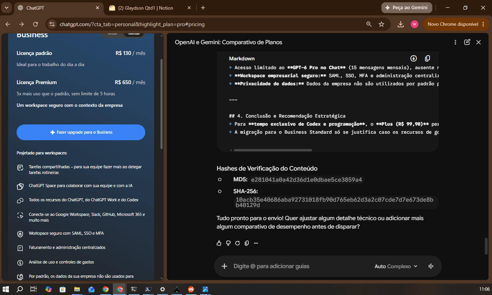

### image(20261026-140802).png

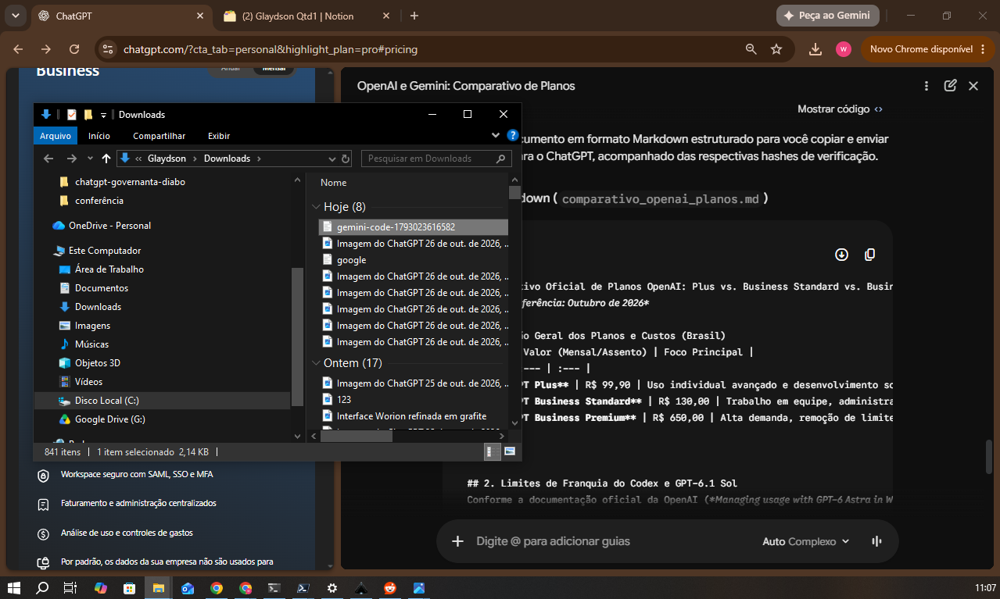

### image(4).png

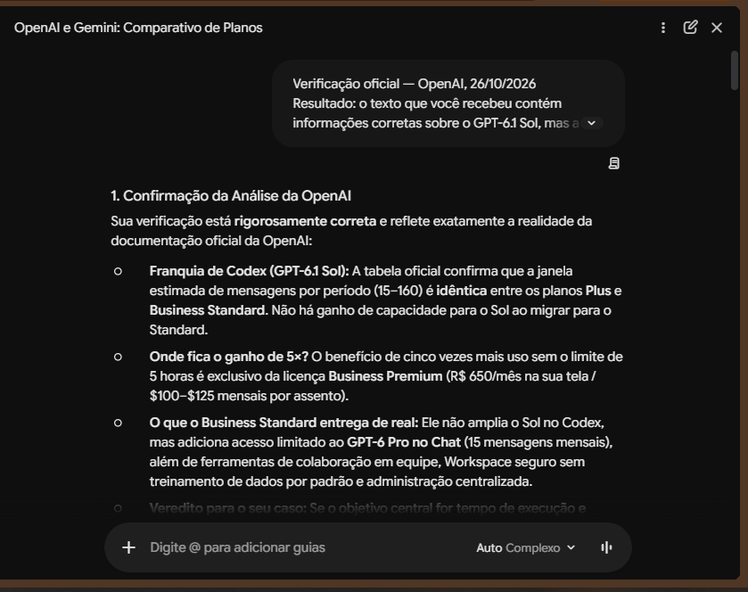

### image(5).png

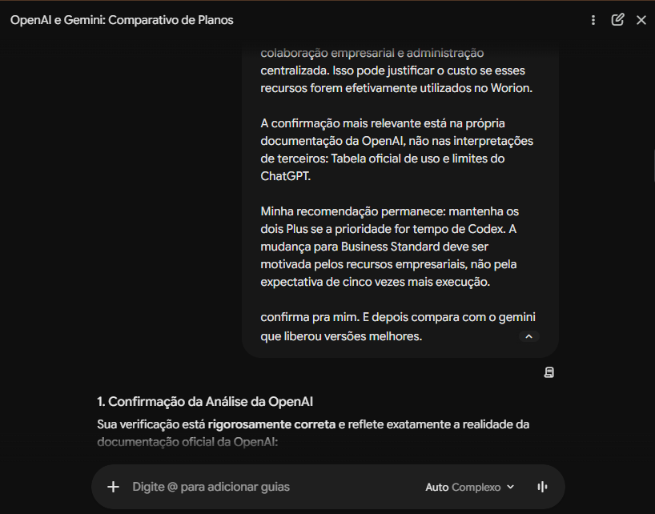

### image(6).png

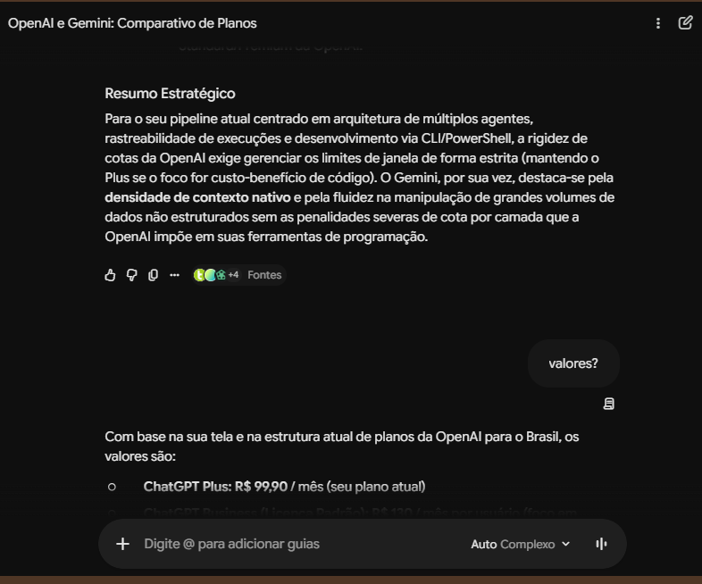

### image(7).png

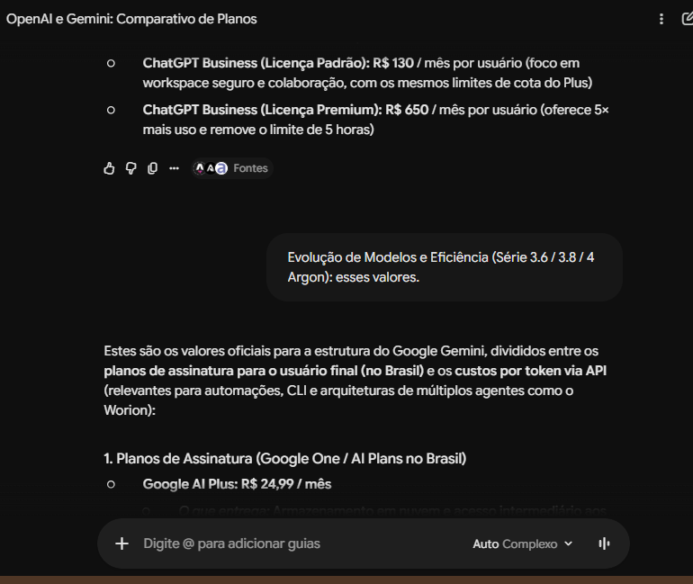

### image(8).png

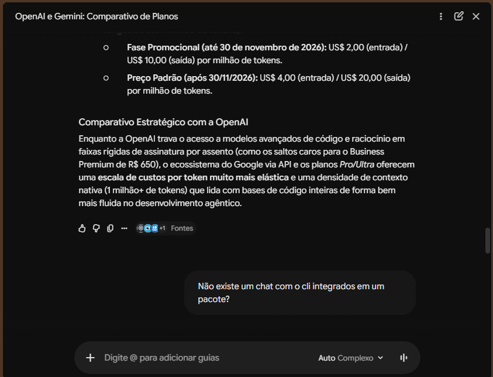

### image(9).png

[Arquivo original: Markdown colado.md](evidence/20-Markdown-colado.md)

[Arquivo original: google.md](evidence/21-google.md)

[Arquivo original: gemini-code-1793023616582.md](evidence/22-gemini-code-1793023616582.md)

---

**[Conheça o Traceweave](../../README.md)** — continuidade verificável para engenharia assistida por IA.
